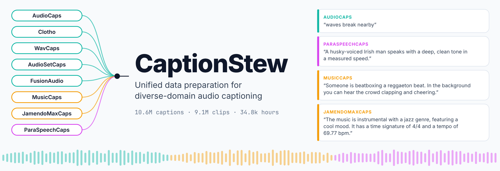

# CaptionStew: Unified Data Preparation for Diverse-Domain Audio Captioning

<p align="center">
  
</p>

This repository provides easy-to-follow recipes to download the audio of **CaptionStew**, a collection of more than
10 million audio captions spanning diverse domains, and to pair every clip with its metadata and captions. 

**CaptionStew** is introduced and used as the training dataset for our ACL 2026 Long paper
[Revisiting Audio-language Pretraining for Learning General-purpose Audio Representation](https://arxiv.org/abs/2511.16757).

**CaptionStew** aggregates eight open-source audio caption datasets:
[AudioCaps](https://aclanthology.org/N19-1011/),
[Clotho](https://arxiv.org/abs/1910.09387),
[MusicCaps](https://arxiv.org/abs/2301.11325),
[WavCaps](https://arxiv.org/abs/2303.17395),
[AudioSetCaps](https://arxiv.org/abs/2411.18953),
[FusionAudio](https://arxiv.org/abs/2506.01111),
[JamendoMaxCaps](https://arxiv.org/abs/2502.07461) and
[ParaSpeechCaps](https://arxiv.org/abs/2503.04713).
Together they provide **10.6M captions** for 9.1M audio clips, covering environmental sound, music and expressive speech.
The captions differ in *descriptive focus* (which attributes of the audio they describe) and *granularity* (how much
detail they give about those attributes). The captions are published on Hugging Face at
[`RayTseng0406/CaptionStew`](https://huggingface.co/datasets/RayTseng0406/CaptionStew) as
[Lhotse](https://github.com/lhotse-speech/lhotse) manifests. Hosting the audio itself would raise complex licensing
issues, so this repository instead provides runnable scripts that download it from the original sources, one recipe per
audio source.

This branch adds support for the **Qwen3-Omni captions** of CaptionStew 10M ([Outcome C](#outcome-c-captionstew-10m-with-qwen3-omni-captions)).

## What you get

Following this repository produces Lhotse manifests that point to your local audio, in any of three forms:

| Outcome | Caption files on Hugging Face | Linked manifests | Audio needed |
|---|---|---|---|
| **A. CaptionStew 10M (CS10M)**, the full training corpus of the paper | [`10M/shard_{0..9}.jsonl.gz`](https://huggingface.co/datasets/RayTseng0406/CaptionStew/tree/main/10M) | `manifests/10M/shard_{0..9}.jsonl.gz` | all sources |
| **B. One manifest per caption dataset** | [`dataset_splits/<dataset>.jsonl.gz`](https://huggingface.co/datasets/RayTseng0406/CaptionStew/tree/main/dataset_splits) | `manifests/dataset_splits/<dataset>.jsonl.gz` | only that dataset's sources (see [Outcome B](#outcome-b-one-manifest-per-caption-dataset)) |
| **C. CaptionStew 10M with Qwen3-Omni captions** | [`manifest/CaptionStew_10M_30s_{00..09}.jsonl.gz`](https://huggingface.co/datasets/eureka1500/CaptionStew10M-Qwen3Omni/tree/main/manifest) | `manifests/qwen3omni/CaptionStew_10M_30s_{00..09}.jsonl.gz` | all sources (or only those of the shards you link) |

In CS10M, captions of the same clip coming from different caption datasets are merged into one caption list (9.12M
cuts, 10.58M captions). The per-dataset manifests keep each caption dataset separate, so a clip can appear in several of
them (e.g. an AudioSet clip in AudioCaps, AudioSetCaps and FusionAudio).

Every linked cut carries the audio path, the audio metadata read from your file (sampling rate, number of samples,
channels), its start/duration, and its captions in `supervisions[0].custom.caption` (a list).

## How it works

1. **Download the captions** (`download_captions.sh`). Each caption manifest refers to its audio with a path key such as
   `audioset/unbalanced/Y4K8P4BoufRM`: the audio source, then the file's path relative to that source's root folder,
   without extension.
2. **Download the audio** of each source with its recipe in `dataset/`. Every recipe produces exactly the folder layout
   the path keys expect.
3. **Link** (`link_captions.py`). Resolves every key to a local file, reads the sampling rate, length and channel count
   from the file, writes ready-to-use manifests and reports which clips are missing.
4. **Validate** (`validate.py`). Checks the linked manifests and decodes a sample of cuts.

## Audio sources

| Source (`--root` name) | Download from | Clips used | Hours | Download size | Recipe |
|---|---|---:|---:|---:|---|
| `audioset` | HF [`Muno459/AudioSet`](https://huggingface.co/datasets/Muno459/AudioSet) | 1.84M | 5,058 | 2.4 TB | [dataset/AudioSet](dataset/AudioSet) |
| `youtube4m` | Google Drive (link on request, see recipe) | 4.02M | 11,168 | ~600 GB | [dataset/YouTube4M](dataset/YouTube4M) |
| `vggsound` | HF [`txya900619/vggsound-16k`](https://huggingface.co/datasets/txya900619/vggsound-16k) | 182k | 504 | 62 GB | [dataset/VggSound](dataset/VggSound) |
| `wavcaps` | HF [`cvssp/WavCaps`](https://huggingface.co/datasets/cvssp/WavCaps) | 240k | 677 | 820 GB | [dataset/WavCaps](dataset/WavCaps) |
| `clotho` | [Zenodo](https://zenodo.org/records/4783391) (Clotho v2.1) | 3,740 | 23 | 4.5 GB | [dataset/Clotho](dataset/Clotho) |
| `jamendo` | HF [`amaai-lab/JamendoMaxCaps`](https://huggingface.co/datasets/amaai-lab/JamendoMaxCaps) | 361k tracks (1.81M windows) | 14,705 | 1.06 TB | [dataset/JamendoMaxCaps](dataset/JamendoMaxCaps) |
| `voxceleb1`, `voxceleb2`, `ears`, `expresso`, `emilia` | VoxCeleb (on request), EARS, Expresso, HF Emilia | 1.03M | 2,684 | | [dataset/ParaSpeechCaps](dataset/ParaSpeechCaps) |

Plan for roughly 5 TB of downloads for CS10M. Most recipes delete archives and parquet shards once their audio is
extracted, so the final audio takes about the same space.

Some clips are no longer available from the public copies: the Hugging Face AudioSet copy has 90.5% of the unbalanced
clips and 99.8% of the balanced clips that CaptionStew uses. `link_captions.py` drops cuts whose audio is missing and
reports the coverage of every manifest.

## Common steps

### 1. Install

    pip install -r requirements.txt

Some recipes also need `ffmpeg`, `7z` (p7zip), `rclone`, and the `hf` CLI (installed with `huggingface_hub`); each
recipe README lists what it uses. Set `HF_TOKEN` to avoid anonymous Hugging Face rate limits.

### 2. Download the captions

    ./download_captions.sh captions                  # 10M/ and dataset_splits/ (~1.8 GB)
    ./download_captions.sh captions 10M              # Outcome A only (~0.9 GB)
    ./download_captions.sh captions dataset_splits   # Outcome B only (~0.9 GB)

The recipes collect the clips they need from `captions/dataset_splits/`, so download it even if you only want CS10M
(`./download_captions.sh captions 10M dataset_splits`, the default). The smaller data-scaling subsets of the paper
(`400k`, `1M`, `4M`) can be downloaded and linked the same way as `10M`.

### 3. Download the audio

Follow the recipe README of each source you need. Keeping every source under one `${audio_root}` is the simplest
layout:

    ${audio_root}/
    ├── audioset/{unbalanced,balanced}/Y<youtube_id>.flac
    ├── youtube4m/batch<N>/<category>/<id>.mp3
    ├── vggsound/<youtube_id>_<start>.wav
    ├── wavcaps/{FreeSound,BBC_Sound_Effects,SoundBible,AudioSet_SL}/<id>.flac
    ├── clotho/development/<file name with spaces replaced by _>.wav
    ├── jamendo/<track_id>.mp3
    ├── voxceleb1/dev/wav/<speaker>/<video>/<utterance>.wav
    ├── voxceleb2/dev/aac/<speaker>/<video>/<utterance>.wav
    ├── ears/p<NNN>/<utterance>.wav
    ├── expresso/audio_48khz/...
    └── emilia/EN/EN_B<NNNNN>/.../mp3/<utterance>.mp3

Sources can also live elsewhere; pass their folders to `link_captions.py` with `--root <source>=<path>`.

## Outcome A: CaptionStew 10M

Download the audio of **all** sources, then link the ten shards:

    python link_captions.py captions/10M/shard_*.jsonl.gz \
      --audio-root "${audio_root}" \
      --output-dir manifests

    python validate.py manifests/10M/shard_*.jsonl.gz --num-decode 50

This writes `manifests/10M/shard_0.jsonl.gz` ... `shard_9.jsonl.gz` (about 0.9 M cuts each), plus
`manifests/link_report.json` with the coverage of each shard per source.

**Keep the shards (recommended).** Shards can be read in parallel, re-linked one at a time, and loaded together with
Lhotse:

```python
from pathlib import Path
from lhotse import CutSet

cuts = CutSet.from_files(sorted(Path("manifests/10M").glob("shard_*.jsonl.gz")))   # lazy, all shards
```

For [Auden](https://github.com/AudenAI/Auden), list each shard as an entry of the training data config.

**One big file (not recommended).** If a tool needs a single manifest, concatenate the linked shards; gzip files can be
concatenated as they are and Lhotse reads the result as one manifest:

    cat manifests/10M/shard_*.jsonl.gz > manifests/CaptionStew_10M.jsonl.gz

The single file (~1 GB compressed, 9.1M lines) can only be read sequentially, takes long to load eagerly, and has to be
rebuilt whenever any shard is re-linked.

## Outcome B: one manifest per caption dataset

Download the audio sources a caption dataset uses, then link its file:

| Caption file (`dataset_splits/`) | Cuts | Hours | Audio sources (`--root` names) |
|---|---:|---:|---|
| `audiocaps_train.jsonl.gz` | 90,859 | 249 | `audioset` |
| `MusicCaps_train.jsonl.gz` | 2,632 | 7 | `audioset` |
| `AudioSetCaps.jsonl.gz` | 1,909,146 | 5,257 | `audioset`, `wavcaps` (AudioSet_SL) |
| `FusionAudio.jsonl.gz` | 1,228,028 | 3,386 | `audioset`, `wavcaps` (AudioSet_SL) |
| `YouTube4M.jsonl.gz` | 4,010,206 | 11,139 | `youtube4m` |
| `VggSound.jsonl.gz` | 181,913 | 504 | `vggsound` |
| `WavCaps.jsonl.gz` | 239,503 | 677 | `wavcaps` |
| `clotho_train.jsonl.gz` | 3,740 | 23 | `clotho` |
| `JamendoMaxCaps.jsonl.gz` | 1,811,159 | 14,705 | `jamendo` |
| `ParaSpeechCaps.jsonl.gz` | 1,034,689 | 2,684 | `voxceleb1`, `voxceleb2`, `ears`, `expresso`, `emilia` |

Link one caption dataset:

    python link_captions.py captions/dataset_splits/WavCaps.jsonl.gz \
      --audio-root "${audio_root}" \
      --output-dir manifests

    python validate.py manifests/dataset_splits/WavCaps.jsonl.gz

or all of them at once (`captions/dataset_splits/*.jsonl.gz`). Each input gives `manifests/dataset_splits/<dataset>.jsonl.gz`.
Each recipe README ends with the linking command for the caption datasets it serves.

## Outcome C: CaptionStew 10M with Qwen3-Omni captions

[`eureka1500/CaptionStew10M-Qwen3Omni`](https://huggingface.co/datasets/eureka1500/CaptionStew10M-Qwen3Omni)
re-captions CaptionStew 10M with Qwen3-Omni-30B-A3B-Captioner, as part of
[Unlocking Strong Supervision: A Data-Centric Study of General-Purpose Audio Pre-Training Methods](https://arxiv.org/abs/2603.25767).
Each caption is a detailed, multi-paragraph description (about 400 words) that ends with a summary paragraph; the
original CaptionStew captions are kept alongside it.

Prepare the audio as for Outcome A, then download, convert and link the captions:

    ./qwen3omni/download_qwen3omni.sh captions_qwen3omni          # ~8.3 GB

    python qwen3omni/convert_qwen3omni.py captions_qwen3omni/manifest/*.jsonl.gz \
      --output-dir captions/qwen3omni \
      --text full

    python link_captions.py captions/qwen3omni/*.jsonl.gz \
      --audio-root "${audio_root}" \
      --output-dir manifests

    python validate.py manifests/qwen3omni/*.jsonl.gz --num-decode 50

`--text` selects what goes into `supervisions[0].custom.caption`:

| `--text` | Caption list |
|---|---|
| `full` (default) | the full Qwen3-Omni caption |
| `summary` | its final summary paragraph, the text used for training in the paper |
| `full+original`, `summary+original` | the Qwen3-Omni text followed by the original CaptionStew captions |

The original captions are always kept in `supervisions[0].custom.original_caption`.

The shards are grouped by audio source, so you can link only the shards whose audio you have prepared:

| Shard | Cuts | Audio sources |
|---|---:|---|
| `CaptionStew_10M_30s_00.jsonl.gz` | 912,931 | `audioset`, `wavcaps` |
| `CaptionStew_10M_30s_01.jsonl.gz` | 912,938 | `audioset` |
| `CaptionStew_10M_30s_02.jsonl.gz` | 912,856 | `jamendo`, `wavcaps`, `audioset`, `clotho` |
| `CaptionStew_10M_30s_03.jsonl.gz` | 912,899 | `jamendo` |
| `CaptionStew_10M_30s_04.jsonl.gz` | 912,929 | `emilia`, `jamendo`, `vggsound`, `wavcaps` |
| `CaptionStew_10M_30s_05.jsonl.gz` | 912,938 | `emilia`, `youtube4m`, `voxceleb1`, `voxceleb2`, `ears`, `expresso` |
| `CaptionStew_10M_30s_06.jsonl.gz` – `09` | 3.41M | `youtube4m` |

Notes:

- The Qwen3-Omni captions cover 8.87M of the 9.12M CS10M cuts; most of the clips without a Qwen3-Omni caption are
  from YouTube-4M (`CaptionStew_10M_30s_08.jsonl.gz` is smaller than the other shards).
- The conversion uses the same path keys and cut IDs as the CaptionStew release, so the Qwen3-Omni and CaptionStew
  manifests can be joined by cut ID.
- Converting all ten shards takes about 3 minutes per shard and writes about 8 GB.

## Linking details

- Any set of manifests can be linked in one run; the output keeps each file's folder name
  (`manifests/10M/shard_0.jsonl.gz`, `manifests/dataset_splits/WavCaps.jsonl.gz`, ...). Outcomes A and B can be written
  to the same `--output-dir`.
- Files may have any common audio extension (`.wav`, `.flac`, `.mp3`, `.m4a`, ...); the actual sampling rate, length
  and channel count are read from each file and cached in `<output-dir>/.audio_info_cache.jsonl`, so linking further
  manifests against the same audio is fast.
- Cuts whose audio is missing are dropped. The coverage table is printed and saved to `<output-dir>/link_report.json`,
  and the missing keys are listed in `<output-dir>/missing_audio.txt`.
- Multi-channel files are used as they are, and the cut reads the first channel. The AudioSet and JamendoMaxCaps
  recipes have a `--downmix` option to store mono audio instead.
- Run with `--check-only` to see the coverage without writing manifests, e.g. while downloads are still in progress.

## Using the manifests

The linked manifests are Lhotse `CutSet`s, the format expected by the CLAP and audio-captioning examples of
[Auden](https://github.com/AudenAI/Auden) used in the paper:

```python
from lhotse import CutSet

cuts = CutSet.from_file("manifests/dataset_splits/clotho_train.jsonl.gz")
cut = next(iter(cuts))
audio = cut.load_audio()                       # (1, num_samples) at the file's sampling rate
captions = cut.supervisions[0].custom["caption"]
```

Models in the paper resample all audio to 16 kHz (e.g. `cuts.resample(16000)`).

## Repository layout

    download_captions.sh     download the caption manifests from Hugging Face
    link_captions.py         link caption manifests to local audio
    validate.py              check linked manifests
    common/                  helpers shared by the recipes
    dataset/<Source>/        one recipe (README + scripts) per audio source
    tools/                   maintainer tools for building the Hugging Face release
    qwen3omni/               download and convert the Qwen3-Omni captions (Outcome C)

## Changelog

- **2026-10**: Initial release of CaptionStew-data-prep: recipes to download the audio of every CaptionStew source and
  link it to the captions on Hugging Face.
- **2026-11**: Added the Qwen3-Omni captions of CaptionStew 10M (Outcome C).

## Disclaimer

This repository has not yet been extensively tested. If you run into a problem or have a suggestion, please
[open an issue](https://github.com/RayTzeng/CaptionStew-data-prep/issues) or submit a pull request.

## Citation

If you find this repository useful, please consider citing the following work:
```bibtex
@article{tseng2025revisiting,
  title={Revisiting Audio-language Pretraining for Learning General-purpose Audio Representation},
  author={Tseng, Wei-Cheng and Zhou, Xuanru and Huo, Mingyue and Shao, Yiwen and Zhang, Hao and Yu, Dong},
  journal={arXiv preprint arXiv:2511.16757},
  year={2025}
}

@article{zhou2026unlocking,
  title={Unlocking Strong Supervision: A Data-Centric Study of General-Purpose Audio Pre-Training Methods},
  author={Zhou, Xuanru and Shao, Yiwen and Tseng, Wei-Cheng and Yu, Dong},
  journal={arXiv preprint arXiv:2603.25767},
  year={2026}
}
```

Please also cite the source datasets listed in each recipe README.
